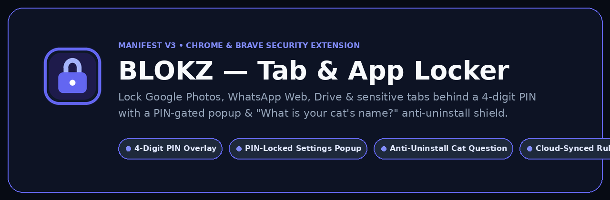
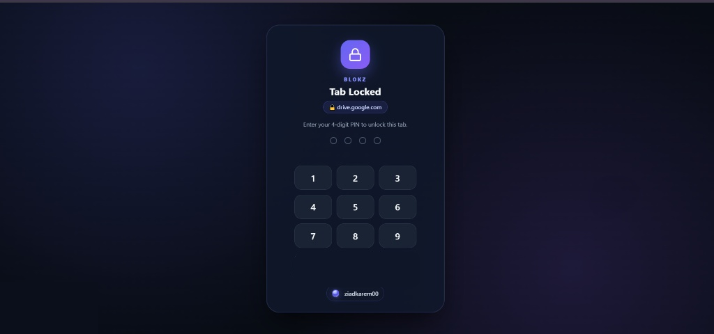
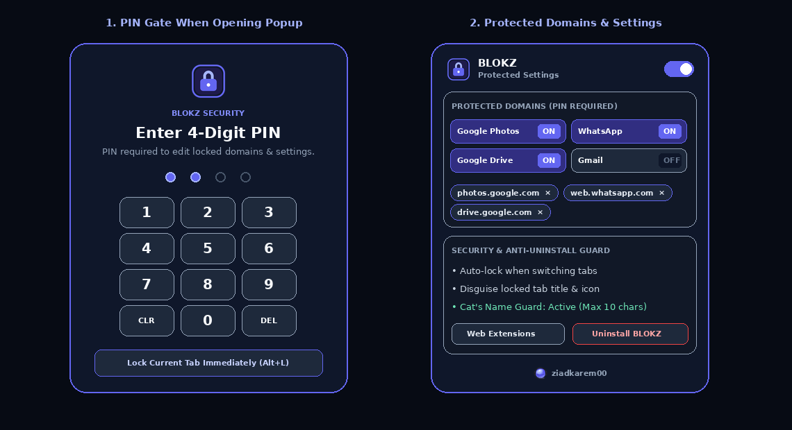
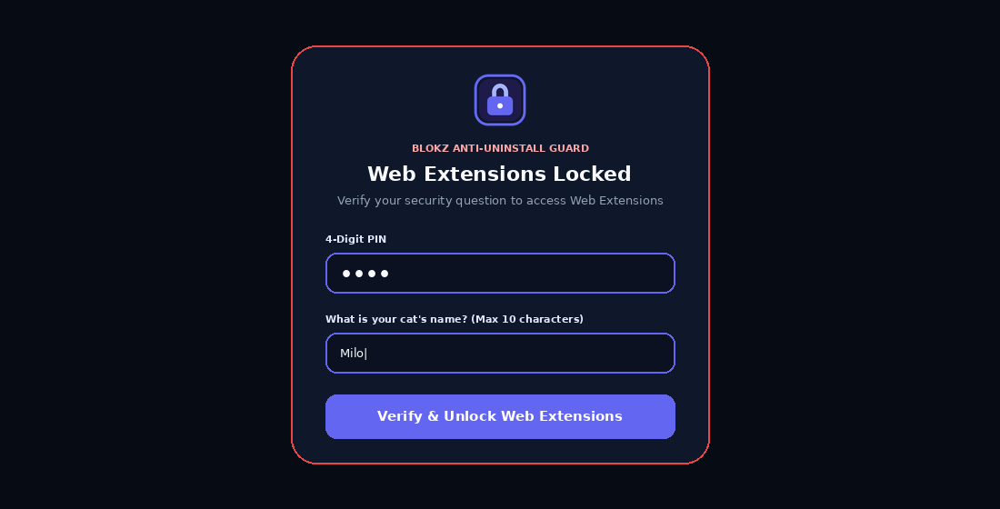

<div align="center">



# 🔒 BLOKZ — Tab & App Locker

**Protect Google Photos, WhatsApp Web, Google Drive, Gmail, and any sensitive browser tab behind a zero-flash 4-digit PIN & anti-uninstall security shield.**

[](https://github.com/ziadkarem00/blokz)
[](https://github.com/ziadkarem00/blokz)
[](https://github.com/ziadkarem00)

</div>

---

## ✨ Why BLOKZ?

Leaving your laptop open for a minute shouldn't expose your private **Google Photos**, **WhatsApp Web** chats, or **Google Drive** files. **BLOKZ** is a lightweight, cloud-synced Chromium extension that locks sensitive tabs the instant they open—or the moment you switch tabs—and prevents anyone from sneaking into your extension settings to turn it off.

### 🚀 Core Features

- **⚡ Zero-Flash Instant Tab Shield (`document_start`)**: Blurs and masks protected pages before a single photo or message renders, pauses active media, and disguises the tab title and favicon as `🔒 Locked — BLOKZ`.
- **🔐 PIN-Locked Extension Popup**: Clicking the BLOKZ toolbar icon requires your **4-digit PIN** before anyone can view, add, or remove locked domains.
- **🐱 Anti-Uninstall Security Question (`"What is your cat's name?"`)**:
  - Right after setting your 4-digit PIN, BLOKZ asks **"What is your cat's name?"** (up to 10 characters).
  - Whenever someone tries to open `brave://extensions` or `chrome://extensions` to delete the extension—or tries to disable BLOKZ protection—BLOKZ intercepts the tab and requires both your **4-digit PIN** and your **cat's name**.
- **🔄 Auto-Relock on Tab Switch & Idle Timer**: Automatically re-locks unlocked tabs the moment you switch to another tab or after 1, 5, or 15 minutes.
- **⌨️ Panic Hotkeys**:
  - `Alt + L` — Instantly lock the current tab.
  - `Alt + Shift + L` — Instantly re-lock all protected tabs across the browser.

---

## 📸 Screenshots

### 1. Sleek 4-Digit PIN Tab Lock Screen
> Automatically locks protected domains (`photos.google.com`, `web.whatsapp.com`, `drive.google.com`, `mail.google.com`, or any custom site) inside an isolated closed Shadow DOM.

<div align="center">
  
</div>

### 2. PIN-Gated Popup & Protected Domain Settings
> Nobody using your laptop can open the extension popup and remove WhatsApp or Google Photos from your locked list without entering your 4-digit PIN first.

<div align="center">
  
</div>

### 3. Anti-Uninstall Security Guard (`"What is your cat's name?"`)
> Intercepts attempts to open `brave://extensions` or `chrome://extensions` and requires your 10-character security answer before unlocking extension management.

<div align="center">
  
</div>

---

## 🛠️ Installation (Brave / Chrome / Edge)

1. Download or clone this repository (or extract `BLOKZ-Tab-Locker.zip`).
2. Open your browser and go to `brave://extensions/` (or `chrome://extensions/`).
3. Turn ON **Developer mode** in the top-right corner.
4. Click **Load unpacked** in the top-left corner and select the `BLOKZ` folder.
5. Click the **BLOKZ** icon in your toolbar:
   - **Step 1**: Enter your **4-digit PIN**.
   - **Step 2**: Answer **"What is your cat's name?"** (max 10 characters).
6. **Pro Security Tip for Brave / Chrome**: Once configured, **unpin** BLOKZ from the top toolbar (click the puzzle-piece Extensions icon → unpin BLOKZ). That way, no one can right-click the toolbar icon to use the browser's native remove button, and any attempt to open `brave://extensions` will be blocked by the **"What is your cat's name?"** guard screen!

---

## 📁 Repository Structure

```text
blokz/
├── manifest.json          # Manifest V3 configuration
├── background.js          # Service worker (SHA-256 PIN & Cat's Name guard)
├── content.js             # Zero-flash closed Shadow DOM lock screen
├── popup.html             # PIN-gated extension popup UI
├── popup.css              # Dark glassmorphic popup styling
├── popup.js               # Popup controller & security question workflows
├── guard.html             # Anti-uninstall shield for brave://extensions
├── guard.js               # Verification controller for extension manager access
├── icons/                 # Extension & attribution icons
│   ├── icon16.png
│   ├── icon32.png
│   ├── icon48.png
│   ├── icon128.png
│   └── ziad-emoji.png
├── screenshots/           # README showcase screenshots
│   ├── banner.png
│   ├── lock-screen.png
│   ├── popup-settings.png
│   └── brave-guard.png
└── README.md              # Project documentation
```

---

## 👤 Author

Built by **[ziadkarem00](https://github.com/ziadkarem00)**.
